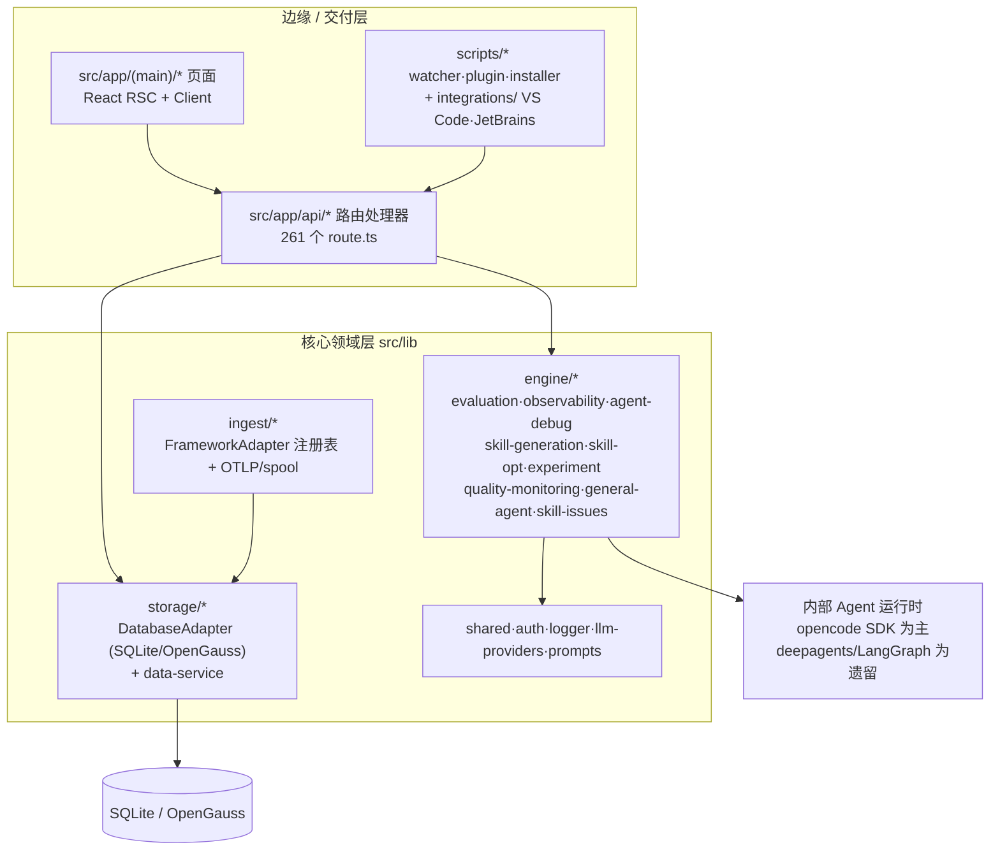
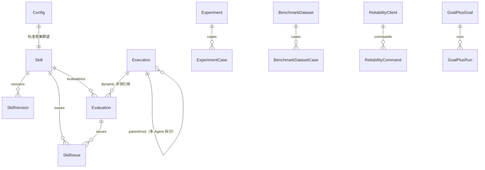

# Agent Insight 项目解读

> 这份文档不是官方 README 的替代品，而是一份**给新接手者的通读笔记**：先讲清「这是什么、由哪些部件组成、一次数据怎么流过它」，再讲清「当前做到哪一步、哪里还没做完、哪里有坑」。
>
> 官方产品说明见 [`README.md`](README.md)；开发者架构文档见 [`docs/developer-guide/INDEX.md`](docs/developer-guide/INDEX.md)。
>
> 本文所有结论均可回溯到文件，标注方式：`[实证]` = 我读过代码/文件并确认；若某项是推测，会显式写「推断」。**本文几乎全部结论都是 `[实证]`**，核实方法见文末附录。

---

## 1. 一句话定位

**Agent Insight 是一个自托管、框架无关的 AgentOps 平台**，围绕 Agent 的全生命周期提供五件事：

| 能力 | 一句话 | 关键落点 |
|---|---|---|
| 观测 | 把 Agent 运行链路从黑盒变成可读的调用树 | `src/lib/engine/observability/`、`/trace` |
| 评测 | 对结果、轨迹、可靠性、Benchmark 多维度打分 | `src/lib/engine/evaluation/`、`/experiments` |
| 诊断 | 五维认知归因，定位失败根因 | `src/lib/engine/agent-debug/`、`/fault` |
| 优化 | Skill 生成 → 评测 → 优化 → 发布的闭环 | `src/lib/engine/skill-{generation,opt}/`、`/skills` |
| 可靠性 | 事前故障注入、事中检测恢复、事后演进 | `agent_ras/`、`agent_fault_injection/` |

它的**差异化主张**是把 **Skill（带版本的 Agent 能力，一个含 `SKILL.md` 的文件夹）当作一等公民**——能生成、能 A/B、能评测、能被自动优化。`[实证]`（`docs/developer-guide/00-positioning.md`、`prisma/schema.prisma` 的 `Skill` + `SkillVersion`）

---

## 2. 快速事实卡

| 项 | 值 |
|---|---|
| 包名 / 版本 | `agent-insight` @ **0.9.0** `[实证]` `package.json:3` |
| 形态 | **模块化单体**：单个 Next.js 全栈进程（UI + API + 领域引擎同进程），外加一个 CLI 安装器 `bin/cli.js` |
| 主技术栈 | Next.js 16.1.4（App Router）· React 19 · TypeScript 5.9.3（strict）· Prisma 5.22 · Tailwind 4 · OpenTelemetry · LangChain/LangGraph + deepagents |
| 运行环境 | Node.js >= 20，默认端口 3000 `[实证]` `package.json` |
| 默认存储 | SQLite（`~/.agent-insight/data/witty_insight.db`）；可通过 `DatabaseAdapter` 切换到 OpenGauss(pg) `[实证]` `src/lib/storage/db-interface.ts` |
| 代码规模 | `src/` 下 **1047** 个 `.ts/.tsx`；**261** 个 API route `[实证]` |
| 数据模型 | **88** 个 Prisma model，`schema.prisma` 2075 行 `[实证]` |
| 预置评估器 | **34** 个产品卡（`preset-evaluators.ts`）；注册表白名单 `PRESET_META` 共 **35** 项 `[实证]` |
| 已接入平台 | 官方声称 16 个（OpenCode / Claude Code / Codex / Qwen Code / Hermes / Trae / JiuwenSwarm / LangChain / LlamaIndex / OpenClaw / Pi Agent / Qoder CN / DeepSeek Harness / xiaoO / CodeAgent / AcTrail）`[实证]` `README.md:55-72` |
| 测试文件 | `test/` 下 **390** 个 `.test.ts` + 6 个 `.test.mjs`；另有 4 个独立 Python 子项目自带测试 `[实证]` |
| 许可 | MIT（openEuler 社区项目） |

> ⚠️ 注意：仓库里 `00-positioning.md` 仍写「版本 0.7.0-beta、38 个测试文件」，`README.md` 的 Docker 示例仍写 `0.5.0`。**文档版本号是滞后的，以 `package.json` 为准。** `[实证]`

---

## 3. 核心内容：它由什么组成

### 3.1 分层架构



**设计铁律** `[实证]`（`docs/design/framework-adapter-registry/phase2`）：

- **适配器是纯函数** —— 解析层不碰 DB、不碰网络，只做转换。
- **入库唯一出口是 `saveExecutionRecord`** —— 所有平台的 trace 最终都归一到同一条路径。
- **下层不依赖上层** —— `storage/` 不 import `engine/`；`engine/` 不 import `client/`。规则写在 `src/lib/README.md`。

### 3.2 功能地图（侧边栏 IA 是权威）

权威来源 `src/components/shell/sidebar-navigation.ts` `[实证]`：

| 一级 | 二级 / 路由 | 对应 API 域 |
|---|---|---|
| — | 仪表盘 `/dashboard` | `api/dashboard`, `api/fleet/reliability` |
| — | 快速开始 `/quickstart` | 纯前端引导 |
| **运行观测** | Agent 概览 `/agents` | `api/agents` |
| | 链路追踪 `/trace`(+`/details`) | `api/observe` |
| | 版本分析 `/version-analysis`(+`/version-management`) | `api/observe`、`api/tags` |
| | 推理基础设施 `/infra`(+`/infra/source/:id`) | `api/observe/infra`、`lib/infra` |
| **评测中心** | 实验 `/experiments` | `api/experiments`、`engine/experiment` |
| | 评测数据集 `/dataset` | `api/agent-datasets` |
| | 评估器 `/metrics` | `api/user-evaluators`、`lib/evaluators` |
| **诊断分析** | `/fault` | `api/fault`、`api/debug`、`engine/agent-debug` |
| **持续优化** | Skill `/skills`（含 `/skill-workbench`、`/skill-history`、`/skill-detail`、`/skill-generator`、`/skill-eval`、`/skill-opt`） | `api/skills`、`api/skill-*` |
| **配置** | `/config/skills`、`/modelconfig/registry`、`/modelconfig/web-search`、`/accessconfig/install`、`/accessconfig/client` | `api/skill-management`、`api/eval/settings`、`api/ingest/setup` |
| | 用量统计 `/usage`（ADMIN 徽标，仅管理员可见） | `api/admin/usage` |

**存在但没有任何导航入口的页面** `[实证]`（我在全仓 `src/` 搜索过这些路径的入链）：

`/quality`（质量监控，页面 + 7 个组件 + `/api/quality/*` 全部实现）、`/goal-plus`（仅详情页链回列表，列表页无入链）、`/memory`、`/optapi`、`/security`、`/skill-release`、`/evaluation`。

> 这些是**靠手输 URL 才能到达**的功能。`/quality` 尤其值得注意：它是 2026-06-23 立项、状态「🟡 实现中（浏览器验收待确认）」的正式需求，代码完整却没有入口。

### 3.3 数据模型：三条主线

`prisma/schema.prisma`（88 model）围绕三组实体组织 `[实证]`：



要点：

- **Execution 多 Agent 拆分** `[实证]`：一次主 trace 拆成 1 条 root + N 条 sub-agent，用 `parentExecutionId` / `rootExecutionId` 串成树；列表默认按 `isSubagent=false` 过滤。
- **评测两表设计** `[实证]`：`Evaluation`（按 `type` 分 static/dynamic/trigger）+ `SkillIssue`（一行一个优化点，`source` 从 `Evaluation.type` 反范式化以避免热路径 join）。旧的 `SkillOptimizationPoint` 单表已废弃。
- **JSON-as-string 蔓延** `[实证]`：大量字段用 `String` 存 JSON（`tags`、`casesJson`、`configJson`、`itemsJson`、`taskEnvelopeJson`…）。根因很明确——`schema.prisma:7` 是 `provider = "sqlite"`，**没有原生 JSON 列、没有数组、也没有数据库级枚举**（整个 schema **零 `enum` 块**，所有状态都是 `String` + 注释，取值真源在 TS 侧的字面量联合）。代价是：类型安全弱、**无法索引、无法下推过滤**，只能读全量再在应用层解析——这正是 §4.7 那个 44 MB 问题的物理根因。
- **用户隔离**：几乎所有表带 `user` 字段并入唯一约束（如 `Skill @@unique([name, user])`）。注意仓库**没有 `src/middleware.ts`**，且 `resolveUser` 对 `?user=` 查询参数不做凭据校验——用户态路由的隔离强度依赖调用方诚实性。

### 3.4 平台接入：4 条采集通道，16 个平台

`[实证]` `src/lib/ingest/adapters/` 下有 16 个框架适配器：`actrail`, `claude`, `codeagent`, `codex`, `deepseek-harness`, `hermes`, `jiuwen`, `langfuse-langgraph`, `llamaindex`, `openclaw`, `opencode`, `pi-agent`, `qoder`, `qwencode`, `trae`, `generic`。

通道按平台能力分四类：

1. **OTLP 上报**（标准协议）—— `api/ingest/otel/v1/{traces,logs,metrics}`，根路径 `/v1/*` 做 rewrite 直收 collector。
2. **原生插件** —— OpenCode 插件、Qoder VS Code/JetBrains 插件（`integrations/`）。
3. **Hook 采集器** —— Codex、Qwen Code、Pi Agent、xiaoO，由 `scripts/agent-trace-collectors/` 分发。
4. **日志旁路 / watcher** —— Claude Code、OpenClaw。

客户端安装走 `curl http://<host>:3000/api/ingest/setup | bash` 分发到 Agent 宿主机 `[实证]` `src/app/api/ingest/setup/route.ts`（2582 行，是仓库最大的 route 文件之一）。

**接入契约**：OTLP 属性规范见 `docs/developer-guide/09-otlp-attribute-contract.md`（FR-011）。

### 3.5 评测体系（体量最大的子系统）

> **重要结构性事实：评测是"两条栈"，不是一个统一框架。** 这是我读代码后最想提醒后来者的一点。
>
> - **栈 A —— 平台内 LLM-Judge 栈**：`AgentEvalDataset(casesJson)` → `Experiment/ExperimentCase` → `src/lib/engine/experiment/run-experiment.ts` 分发 15 个 runner → `ExperimentEvalResult`。结果 / 轨迹 / 可靠性三类走这里。
> - **栈 B —— 独立 Benchmark 栈**：`benchmark.yaml` Manifest + 五方法 Adapter + 构建期 Catalog → 客户端控制通道下发 `RUN_BENCHMARK_CASE` → **独立部署的 Evaluator Controller** → 官方 Harness → 归一化投影回 `ExperimentEvalResult`。有自己的一整套 `Benchmark*` 表、Outbox、watchdog、CAS 与续跑机制。
>
> README 说的「四大维度」是这两条栈 + `datasetKind` 四分类的**产品化表述**，代码里既没有四值的 `EvaluatorCategory`，也没有跨栈统一的分维度聚合。

**「四大评估维度」的真实代码对应** `[实证]`：

| README 维度 | 代码形态 |
|---|---|
| **MenchMark** | `datasetKind='benchmark'` + `Experiment.scope='benchmark'` → **栈 B**。注：`MenchMark` 这个词**全仓只在 `README.md:34` 出现过一次**，代码与其他文档零命中 |
| **结果** | `datasetKind='ideal_output'`（默认）；评估器 `category:'res'`；读最终输出 ± 参考答案 |
| **轨迹** | `datasetKind='trajectory'`；评估器 `category:'traj'`；canonical 轨迹事实层 + 离散 Judge + 代码计分 |
| **可靠性** | `datasetKind='reliability'`（系统字段 `fault_injection_type` 必填）；RAS 故障事件 + 三维 Judge |

⚠️ **精度提醒**：`src/lib/evaluators/registry.ts:19` 的 `EvaluatorCategory` 只有 **`'res' | 'traj'`** 两个值。三个可靠性评估器被**显式挂在 `traj` 下**，并带注释「本期不扩 EvaluatorCategory」。所以"四维"是数据集类型与产品叙事口径，**评估器注册表内部只有两分法**。

**34 个预置评估器** `[实证]`（`preset-evaluators.ts` 的产品卡；`registry.ts` 的白名单 `PRESET_META` 共 35 项，多出的一个是 `skill-trigger-analyzer`）大致分六族：

- **结果/内容类**：`result-accuracy`、`result-answer`、`result-faithfulness`、`result-instruction`、`depth-result`、`rigor-content`
- **文本匹配类**：`text-rouge`、`text-exact-match`、`text-entity-f1`、`text-ai-flavor`、`text-format`、`text-language-consistency`、`text-conciseness`、`fluency-text`
- **安全类**：`safety-maliciousness`、`safety-harmfulness`、`safety-criminality`、`safety-refusal`、`content-insensitivity`、`content-controversy`、`content-gender-discrimination`、`hallucination-text`
- **Agent 行为类**：`agent-task-completion`、`agent-trace-quality`、`agent-process-quality`、`agent-step-efficiency`、`agent-tool-utilization`、`agent-tool-selection`、`agent-tool-success-rate`、`task-completion-no-ref`
- **可靠性类**：`ras-reliability`、`ras-reliability-detection-recovery`、`ras-reliability-fault-injection`

  ⚠️ 后两个**仅用于历史结果兼容**，已不再出现在新建实验的可选列表（`docs/user-guide/evaluation/evaluators.md:161`、`registry.ts:67-68`）。
- **创意类**：`creativity-expression`

**打分方法论** `[实证]`（`docs/developer-guide/10-evaluator-development.md`）：禁止自由打分 → 分解 + 确定性汇总 → 三档锚定 → 精确率/召回率/有据性三轴。

**Benchmark 统一接入** `[实证]`：

- `packages/benchmark-protocol/` 定义契约（`agent-task` / `evaluation` / `evaluator` / `executor` 四组 + JSON Schema + 可见性边界校验 `x-agent-visibility`）。
- 构建期 `scripts/benchmark/generate-catalog.cjs` 扫描 `benchmarks/` 下任何含 `benchmark.yaml` 的目录，生成 `generated/benchmark-catalog/` 五个文件（`predev`/`prebuild`/`prepack`/`pretest` 钩子都会触发）。**加 Benchmark 不需要改公共注册表**。
- **目录发现是零代码，但接入本身不是零代码**——五个 Adapter hook、Evaluator Entrypoint、Dockerfile、Smoke 必须手写。文档三处明确否认"零代码纯配置接入"（`benchmark-integration-development-guide.md:27` 等）。
- ⚠️ **`benchmarks/` 下只有 `swe-bench` 一个实例**（`[实证]` 目录列举）。而前端验收计划的前置条件是"完成第二个非 SWE-bench 接入包验证后才对外发布接入指南"——**该前置条件尚未满足**。

### 3.6 智能诊断（AgentDebug）

`[实证]` `src/lib/engine/agent-debug/` + `docs/agentdebug-diagnosis-principle-and-loop-detection-gap.md`：

- **五维认知归因**：记忆 / 反思 / 规划 / 行动 / 系统。
- **三阶段分析**：预检 → 检测 → 归因，融合确定性规则与 LLM 语义判别。
- 入口 `/fault`，是一个对话式诊断台；主诊断与 Skills 步骤核验已拆成独立存储和独立轮询链路（先完成先展示）。
- 测试用例集在 `test/diagnosis-agent/`，按 L1–L6 分层（单点单模块 → 跨步错误传播 → 边界拒绝 → 脚本静态 vs LLM 语义 → phase0 预检）。

### 3.7 Skill 闭环：生成 → 评测 → 优化

`[实证]` `src/lib/engine/skill-generation/`、`skill-issues/`、`skill-opt/`、`src/lib/skill-workbench/`，原理见 `docs/skill-generation-principle-and-pipeline.md` 与 `docs/skill-optimization-principle-and-closed-loop.md`。

闭环的四道保险：

1. **问题归并** —— 问题去重排序，降本提效。
2. **编辑范围约束** —— 规避优化器误删、大幅改动基线脚本（`skill-opt-edit-scope.test.ts`）。
3. **自验证闭环** —— 优化后效果不劣于基线（`skill-opt-self-verify-structural.test.ts`、`-script-truth.test.ts`）。
4. **对话工作台重构** —— 把生成、上传、静态评估、三类实验、候选优化、复测、确认发布收敛到共享工作版本与会话上下文（`skill-workbench-refactor` 需求）。

### 3.8 可靠性：两个独立的环

这是本项目最"重"的差异化部分，也是**两个物理上独立、逻辑上互补**的子系统：

#### (A) Agent RAS —— 环内（in-process）检测 + 自动恢复

`[实证]` 源码 `agent_ras/`（Python + JS/TS 混合），文档 `docs/agent-ras/`。

- **分层**：L0 采集 → L1 门面（`ras_runtime/facade.py`）→ L2 平台挂载（`platform_adapter/`）→ L3 语义评审 Skill。
- **模块链**：`Monitor` 编排 → `detectors/` 检测 → `recovery/` 生成动作 → Host 投递 → `review/` L3 语义复核。
- **已落地的检测器** `[实证]`（`agent_ras/detectors/`）：`repeat_tool.py`（工具重复死循环）、`llm_thinking_loop.py`（思考死循环）、`analysis_paralysis.py`（分析瘫痪二阶段）、`skill_verdicts.py`（L3 Skill 判定）。
- **恢复策略** `[实证]`（`agent_ras/recovery/`）：`repeat_tool.py`、`llm_thinking_loop.py`、`analysis_paralysis.py`、`stream abort`（环内打断 `llm.stream`）、`robustness_prompt.py`。
- **故障域插件化** `[实证]`：`detectors` / `review` / `recovery` 三个平级目录各自扫描 PLUGIN，共同文件只留 YAML。
- **平台挂载** `[实证]`（`agent_ras/platform_adapter/`）：`opencode/`（JS 插件，同进程 libpython 桥）、`openjiuwen/`（Python Rail + stream observer）、`pi/`（TS Extension + koffi FFI 桥）、`xiaoo/`（Python hooks + Daemon SSE）。
- **上报旁路**：`/api/ingest/ras-events`，非 OTLP。
- **安装**：`npx agent-insight install-ras`，runtime 落到 `~/.agent-insight/ras/runtime/`。

#### (B) Agent Fault Injection —— 事前注入引擎

`[实证]` 源码 `agent_fault_injection/`，文档 `docs/agent-fault-injection/`。

- **结构**：`fault_inject/`（catalog + injection + skills 剧本）、`pipeline/`（runner + monitor + collect_payload）、`platform_adapters/`。独立 Python 包，有 `cli.py` 与自己的 `pyproject.toml`。
- **故障模式剧本** `[实证]`（`fault_inject/skills/` 下 **17** 个 Skill 目录，其中 10 个带 `fault.json` 声明）：

| 故障模式 | 注入机制 |
|---|---|
| `analysis-paralysis` | Skill 剧本 |
| `compositional-implicit-intent` | Skill + assets + 校验脚本 |
| `execution-goal-drift` | Skill + `goal_state_tool.py` |
| `intermediate-conclusion-drift` | Skill + assets |
| `memory-file-loss` | Skill + `MEMORY.md` 资产（FI-P0 已落地） |
| `memory-noise-interference` | Skill S1–S3 + middleware S4 |
| `planning-logic-error` | Skill 剧本 |
| `ras-early-stop` | Skill 剧本 |
| `skill-selection-conflict` | Skill + 正解/诱饵资产 |
| `step-omission` / `step-order-error` | Skill 剧本 |
| `thinking-dead-loop` | Skill 三场景强制复读 |
| `tool-argument-error` | Skill + 参数校验脚本 |
| `tool-observation-delta` | Skill + 资产 |
| `tool-selection-error` | Skill 剧本 |
| `tool_repeat_dead_loop` | Skill 四场景串行连打 |
| `unverified-success` | Skill + 两个条件测试脚本 |

- **服务端 / 客户端分离** `[实证]`：任务下发与展示留在服务端，注入编排在本机 **FI Worker**；Worker 通过 `api/fault-injection/worker/{claim,heartbeat,commands}` 拉任务，通过 `runs/[runId]/collect-result` 回传。
- **证据边界** `[实证]`：注入工具不写自证快照；Judge 以轨迹为主；`no_trace` → `inconclusive`。

#### (C) 可靠性控制面

`[实证]` `src/lib/reliability/`（19 个文件）+ `ReliabilityClient` / `ReliabilityCommand` / `ReliabilityConfig*` 等 9 张表：

常驻客户端 + `configRef` 控制面、systemd/launchd 保活、Prisma 配置下发、WSS/长轮询双向通信。**规划中新客户端会吸收 FI Worker**。

---

## 4. 当前工作与待优化点

### 4.1 官方需求清单的状态分布

权威跟踪表是 `docs/design/README.md`（60 条需求）。我按它的「是否实现」列统计 `[实证]`：

| 状态 | 条数 | 含义 |
|---|---|---|
| ✅ 已实现 | **28** | 全部落地并通过验收 |
| 🟡 实现中 / 🟢 待验收 | **27** | 代码写了，但**未完成浏览器/部署验收** |
| ⬜ 未实现 | **5** | 仅有设计，代码未动 |

**最值得注意的结构性事实：真正"未实现"的只有 5 条，但有 27 条卡在「代码完成、验收未完成」。** 也就是说，这个项目当前的瓶颈不是"没做"，而是**验证与收口**。

### 4.2 标为「未实现」的 5 条（⚠️ 其中 2 条标记有误）

先说结论：这 5 条里**只有 3 条是真的没做**。另外 2 条是**状态标记错误**，详见 §4.5。

| 需求 | 阻塞点 |
|---|---|
| **LLM 过度思考（Analysis Paralysis）二阶段检测** | `docs/design/README.md` 标 `⬜ 未实现` —— **但这个标记是错的**，见 §4.5 |
| **LLM Agent 规划错误（Planning Error）检测** | 策略层规划错误，按信息完备度分层检测与恢复；`agent_ras/detectors/` 下确认无对应实现 |
| **LLM Agent 领域认知偏差（Domain Cognitive Bias）** | 六类信念层故障 + 认知层三角覆盖；FI 剧本 + RAS 检测规则均未动 |
| **Openclaw 平台适配** | 设计仍在起草（描述字段本身写着「待补充」），状态标 `⬜ 未实现` —— **但代码是完整的**，见 §4.5 |
| **Claude Code OTel 工具输出采集补全** | 遗留 bug：官方 OTel logs 的 `tool_result` 只有 metadata、raw API body file 模式未产出 `body_ref`、本地 transcript 有工具输出但平台 trace 仍缺 output；**尚未在三个候选补充源之间选定方案** |

### 4.3 已实现但没有导航入口的页面（最容易被忽略的一类）

`[实证]` 全仓搜索入链后确认：

| 路由 | 实现完整度 | 问题 |
|---|---|---|
| `/quality` | 完整（页面 + 7 组件 + `/api/quality/*`） | **零入链**，侧边栏无入口 |
| `/goal-plus` | 完整（列表 + 详情） | 仅详情页链回列表，**列表页无入链** |
| `/memory`、`/optapi`、`/security`、`/skill-release`、`/evaluation` | 各有 `page.tsx` | 零入链 |

`/goal-plus` 尤其讽刺：它是 2026-09-02 立项的**活跃需求**，状态「🟡 待真实宿主及浏览器验收」，却连导航入口都没有。

### 4.4 技术债与代码层不一致

1. **「冻结分母」承诺没有兑现——文档与实现分歧，且有指标正确性后果** `[实证]`（本次最有实质影响的一条）：

   文档 **4 处**承诺 Benchmark 聚合使用冻结的 `expectedCaseCount` 作分母：

   - `docs/design/benchmark/README.md:72`：「以冻结的 `expectedCaseCount` 作为分母」
   - `docs/design/benchmark/result-processing.md:170`：「实验只有在 `terminalCaseCount === BenchmarkExperimentBinding.expectedCaseCount` 时才进入 `done`」
   - `result-processing.md:178`：「boolean primaryMetric 使用 `trueCount / expectedCaseCount`，**失败和未知不能缩小分母**」
   - `result-processing.md:180`：「Verified 500 的分母始终是冻结的 `expectedCaseCount`」

   但代码里 `expectedCaseCount` **写入 1 次、被 `select` 2 次、从不参与比较**：

   ```
   src/lib/benchmark/experiment-service.ts:194        expectedCaseCount: preparedCases.length   ← 唯一写入
   src/lib/benchmark/experiment-lifecycle.ts:67       select: { expectedCaseCount: true, ... }  ← 选了不用
   src/lib/benchmark/experiment-result-service.ts:100 select: { ..., expectedCaseCount: true }  ← 选了不用
   ```

   真正被当作分母的是**一句实时 count**：

   ```
   experiment-lifecycle.ts:94      const expectedCount = await prisma.experimentCase.count({ where: { experimentId, deletedAt: null } })
   experiment-result-service.ts:243 const expectedTotal = await benchmarkPrisma.experimentCase.count({ where: { experimentId, deletedAt: null } })
   ```

   正常路径下两者相等（Case 重跑是给**同一个** `ExperimentCase` 新建 `BenchmarkCaseRun`），所以指标平时不漂。但一旦 **Case 被软删除**（`deletedAt` 置位），分母就变小 → `resolveRate` 被抬高 → 恰好违背文档「失败和未知不能缩小分母」的承诺；收敛判定 `terminalRuns !== expectedCount` 同理会让实验**更早**进入 `done`。追加 Case 则使分母变大，`benchmark.yaml` profile 的 500 语义不再成立。

   字段在、契约在、**接线缺失**。修法很小（改读冻结字段），但属于该类问题。

2. **超巨型文件** `[实证]`（按含空行的真实行数 Top 8）：

   | 行数 | 文件 |
   |---|---|
   | 5208 | `src/app/(main)/skill-eval/page.tsx` |
   | 4962 | `src/components/eval/GrayscaleEvaluation.tsx` |
   | 4119 | `src/components/observe/AgentTraceView.tsx` |
   | 3552 | `src/lib/storage/data-service.ts` |
   | 3408 | `src/components/skills/SkillCatalogV2.tsx` |
   | 3405 | `src/app/api/debug/grayscale-tasks/[taskId]/route.ts` |
   | 3209 | `src/components/eval/ExperimentWizard.tsx` |
   | 3149 | `src/app/(main)/skill-generator/page.tsx` |

   5000 行级别的页面组件意味着**单一职责失守、无法单测、改动风险高**。注意 `data-service.ts` 是整个存储层的高层服务，也是重逻辑最集中处。

3. **存储接口弱类型** `[实证]`：`DatabaseAdapter` 接口几乎全是 `any`（`db-interface.ts`），绕开了 Prisma 的类型安全。选它是为了 SQLite/OpenGauss 双实现的可移植性，代价是重构时容易引入运行时错误。

4. **运行时双轨未收敛** `[实证]`：内部 Agent 运行时以 opencode SDK 为主，但 `deepagents` / `LangGraph` 仍作为遗留路径存在（`package.json` 有 4 个 `deepagent:ex*` 脚本，`src/lib/engine/skill-generation/legacy/` 仍在），过渡期维护成本与认知负担是实打实的。

5. **框架适配器治理只做了一半** `[实证]`（需求 `framework-adapter-registry`，状态「🟡 注册表骨架已落地，旧调用点切换与验证待开发」）：第一刀治理三块（skill 抽取 4~5 份拷贝、claude 入库归一化 5 个调用点、框架名值域不统一 `claude`/`claudecode`），注册表骨架有了，**旧调用点尚未切完**。同一模式在 Benchmark 侧也有残留：执行器里有一处按 `benchmark.key` 分支的 SWE-bench 专用接缝（见 §4.6-1）。

6. **JSON-as-string 无约束**：见 §3.3，schema 演进靠注释约定。

7. **单进程单点**：模块化单体没有水平扩展配置，长评测任务与 Web 请求共享同一个 Node 进程资源。值得注意：Benchmark 的几处进程内互斥（如 `Symbol.for('agent-insight.benchmark.reevaluation-lock')`）**不跨进程生效**，其 409 语义在多实例部署下只是建议性的。

8. **设计漂移未收敛** `[实证]`（`AGENTS.md` 自述）：历史上出现 `--sk-*` / `--ev-*` / `--sa-*` / `--gh-*` 局部色板，正在向 `globals.css` 的共享令牌收敛——说明前端样式层曾长期缺乏约束。

9. **少量重复实现与死代码** `[实证]`（低优先级，供清理参考）：`isLoopback` 在 `evaluator-runtime-config.ts` 与 `evaluator-target.ts` 各写一份；状态集合在 `detail-status.ts` / `orchestrator.ts` / `evaluation-scheduler.ts` 三处重复声明；`src/lib/benchmark/presentation.ts:129` 的 `benchmarkColumnText` 无任何 importer；`image-preparation.ts:40` 抛普通 `Error` 而非 `BenchmarkProtocolError`，绕过了统一的结构化错误信封。

### 4.5 文档漂移（我逐条核实过，这是最"便宜"的优化项）

| 位置 | 问题 |
|---|---|
| `docs/design/README.md:59` | 标「Analysis Paralysis **未实现（规划中）**」，但 `agent_ras/detectors/analysis_paralysis.py` + `recovery/analysis_paralysis.py` + `tests/unit_tests/harness/agent_ras/detectors/test_analysis_paralysis_detector.py` 都存在，且 `docs/agent-ras/README.md:46` 自己标的是「已落地」。**两份官方文档直接矛盾。** |
| `docs/design/README.md:44` | 标「Openclaw 平台适配 **未实现（设计起草中）**」，但 `src/lib/ingest/adapters/openclaw.ts`、`src/lib/engine/observability/openclaw-parser.ts`、`scripts/openclaw_watcher_client.ts`、`api/ingest/openclaw/**`、`api/ingest/setup/openclaw-watcher/**`、`test/openclaw-e2e.test.ts` **全部存在**，README 的平台支持表也把 OpenClaw 列为已接入。**该状态标记应从 ⬜ 改为已实现类。** |
| `docs/developer-guide/INDEX.md:27` | 说 FI 的 UI 在 `/agent-ras/fault-injection/tasks`（目录 `/faults`），BFF `/api/fault-injection`。**`/agent-ras` 与 `/faults` 这两个页面路由都不存在**（只有 `/fault`）。BFF 路径是对的。 |
| `src/lib/README.md:3,11` | 引用 `docs/Agent_Insight_Design_Document.md`（**不存在**）；列出 `engine/skills/`（**不存在**，实际是 `skill-generation` / `skill-issues` / `skill-opt`）。 |
| `docs/developer-guide/00-positioning.md:30,32` | 引用 `docs_backup/plans/`（**不存在**）、`docs/PROJECT.md`、`docs/Agent_Insight_Design_Document.md`（**均不存在**）；版本写 `0.7.0-beta`（实际 0.9.0）；测试文件数写「38 个」（实际 390）。 |
| `docs/developer-guide/01-architecture.md:10` | 代码版本锚在 `e0e7917`（`master_0530`），最后更新 2026-06-04，**已明显落后于当前 0.9.0**。 |
| `docs/design/README.md:25` | Goal Plus 需求状态是活跃的，但代码入口无导航（见 §4.3）。 |

### 4.6 工程质量 / 可验证性缺口

1. **有测试在默认门禁里就是红的** `[实证]`（本次最硬的一条发现）：

   `test/benchmark-extension-conformance.test.ts:50` 断言执行器主文件**不含** `SweBench` 字样：

   ```ts
   assert.doesNotMatch(fs.readFileSync(path.join(repositoryRoot, 'services/executor/src/index.cjs'), 'utf8'), /SweBench/)
   ```

   但 `services/executor/src/index.cjs` 实际有 **2 处**命中：

   ```
   :10   const { SweBenchGitSourcePolicy } = require('./benchmarks/swe-bench.cjs')
   :997  ['swe-bench', new SweBenchGitSourcePolicy({ ... })],
   ```

   也就是说执行器里存在一处**按 `benchmark.key` 分支的 Swe-bench 专用接缝**，与该一致性测试的断言（以及"公共能力不判断具体 benchmark"的规范）冲突。**这个文件在 `test/` 下，属于 `npm test` 的默认范围，因此默认门禁应当是失败的。**

   旁证：仓库自己的文档也承认基线不干净——`docs/design/agent-trajectory-evaluation/phase3-development-plan.md:353` 写「仍保留仓库已有 **lint 债**；**全仓测试此前也存在与本任务无关的基线失败**，因此本报告不宣称全仓全绿」。

2. **没有任何 CI** `[实证]`：`.github/` 下**只有** `pull_request_template.md`，没有 workflow 文件。lint、类型检查、测试全靠人手动跑。**这解释了第 1 条为什么能长期存在而不被发现。**

3. **`npm test` 覆盖不全** `[实证]`：

   - 脚本是 `node --import tsx --test "test/**/*.test.ts"` —— 只吃 `.ts`，**6 个 `test/**/*.test.mjs`（全部是 Qwen Code 相关）不在门禁内**。
   - `packages/benchmark-protocol/contracts.test.ts` 不在 `test/` 下，**不跑**。
   - `agent_ras/`（**32** 个 Python 测试 + **5** 个 `.mjs` 测试）、`agent_fault_injection/tests/`（**28** 个 Python 测试）、`scripts/llamaindex_extension/`、`skillbench/` 各自是独立 Python 项目，**完全不在 npm 测试链路里**——即 RAS/FI 这两个最"重"的子系统，主门禁一个测试都没覆盖。
   - 根目录 `tests/` 是**手工用例集**（`skill-generator/cases/*/run.sh`），不是自动化测试。
   - ⚠️ 另需注意：`pretest` 钩子会跑 Catalog 生成器，**重写 `generated/benchmark-catalog/` 的 5 个文件**——即跑一次测试会改动工作区。

4. **测试分布偏「接入/展示」，重逻辑偏薄** `[实证]`：390 个测试文件里，大量是平台接入（`trae-*`、`qoder-*`、`claude-*`、`jiuwen-*`、`pi-agent-*`）、UI 展示契约（`*-presentation`、`*-display`）、以及 Benchmark 脚本存在性校验（`benchmark-*-script.test.ts`）。评测/优化的**端到端**覆盖明显弱于接入层。

5. **测试无法在本机直接验证** `[实证]`：解压出来的目录里 **没有 `node_modules`，也没有 `.next`**，要跑测试必须先 `npm install`（会触发 `postinstall` 的 prisma/sharp 自愈，需要联网）。另外该目录**不是 git 仓库**（无 `.git`），无法用 `git log` 判断改动脉络。

6. **`npm run lint` 是裸 `eslint`**：没有指定路径/glob，是否真在扫全仓需自行确认。

### 4.7 已量化的性能问题

**数据集列表接口 44 MB** `[实证]`（`docs/design/agent-dataset-loading-performance/phase1-requirements-analysis.md:5`）：

> `GET /api/agent-datasets` 当前先读取并解析**全部用户**的 `AgentEvalDataset.casesJson`，再在应用层按用户过滤。远端实测单个用户的列表响应达到 **44.23 MB**，同机请求耗时约 **0.66–0.68 秒**；即使目标用户只有 **831 B** 数据，仍需约 **0.41 秒**。

根因是"应用层过滤 + 整列 JSON 反序列化"。方案（`caseCount` / `referenceCasesJson` / `projectionReady` 三个投影列）已设计并部分落地，验收目标是 44.23 MB → **≤ 10 KB**、P50 < 100 ms；但该需求状态仍是 **🟡 实现中**，`phase3-development-plan.md:11` 的部署步骤（备份数据库、独立目录跑增量 schema、非 3000 端口验证）**尚未执行**。

配套的架构性根因：**数据集样本不是关系表，而是 `casesJson` 单列 JSON**（`AgentEvalDataset`）。设计文档明确"本期不把 JSON cases 拆成独立关系表"，所以这个体积问题只会随数据增长；`trace-to-dataset-backflow/phase1-3-design.md:591` 也登记了同源风险「需要持续关注 `casesJson` 膨胀」。

**轨迹评测的 120,000 字符硬上限** `[实证]`（`agent-trajectory-evaluation/phase2-requirements-design.md:142`）：

> Prompt 保留所有步骤，不做头尾抽样；Prompt 总字符超过 **120,000** 时，本次评估**失败**并提示"完整轨迹超过当前 Judge 上下文限制"，**不得静默截掉中段后出分**。

这是刻意的"宁可失败也不撒谎"设计，但意味着**长轨迹任务无法评测**，是准确性与可用性之间的已知取舍。

### 4.8 已声明的能力边界（Benchmark / 评测服务）

这些不是 bug，是文档里**明确写着"不做"**的口径，但会直接影响可部署性和对外承诺，接手前必须知道 `[实证]`：

| 边界 | 出处 |
|---|---|
| **执行器无法真正网络隔离**：只接受 `network=client-default`；收到 `network=deny` 返回 `POLICY_UNSUPPORTED`，不谎称已隔离 | `docs/design/benchmark/executor.md:202` |
| **终端 Run 的 TTL 回收未实现**，Artifact 与本地摘要目前保留 | `executor.md:281` |
| **评测服务单并发**：`maxConcurrency=1` 硬编码，已有活动任务时新 runId 返回 `409 SERVICE_BUSY` | `evaluator.md:124`、`services/evaluator/src/service.cjs:241` |
| **评测回调接口不校验任何应用层凭证**，必须靠白名单/安全组/防火墙兜。具体是 `/api/benchmark/v1` 下 10 个路由里鉴权不一致：3 个 `evaluations/[id]/{complete,progress,artifacts}` **既无 `authenticateDevice` 也无 `resolveUser`**，唯一"凭证"是路径中不可猜测的 `evaluationId`；另一个 `artifacts/[artifactId]/content` 只信一个请求头。**任何能把请求送进平台内网的调用方都能伪造测评终态**（含上传伪造 evidence 触发归一化） | `evaluator.md:169,371`、`evaluation-dispatch.md:371`，代码已逐行核对 |
| **挂载 Docker Socket = 高宿主权限**，只能在隔离的专用评测机/VM 运行（官方要求 `SYS_ADMIN`） | `evaluator.md:50,107` |
| **ARM64 结果只作开发冒烟，不替代 x86_64 Linux 正式计分验收** | `evaluator.md:7`、`result-processing.md:269` |
| **无评测服务注册中心**；未配置评测地址时任务停在 `EVALUATOR_NOT_CONFIGURED` | `evaluation-dispatch.md:194,228` |
| **不建立 Benchmark / 数据集 / 评估器的业务版本概念**（`protocolVersion` 只表示消息格式，SHA-256 只表示内容完整性） | `evaluation-dispatch.md:401` |
| Benchmark 数据集**首期不做浏览器上传、远程 URL 下载、在线插件市场、自定义 React 渲染器**；也不提供强制删除已被引用数据集 | `dataset-onboarding-and-presentation.md:136,186` |

### 4.9 未挂载到打包产物的东西

`[实证]` `package.json` 的 `files` 与 `RELEASE.md:160`：打包时 `prepack` 会剔除 `exclude/`、`data/`、`tests/`、`skillbench/`。注意 **`skillbench/`（一个完整的 Python Benchmark 子项目）不进 npm 包**——它是仓库内的开发/研究资产，不随产品分发。

---

## 5. 怎么读这个仓库（推荐路径）

针对不同目的，最短路径：

| 我想…… | 读这里 |
|---|---|
| 5 分钟理解全貌 | 本文 §1–§3 → `docs/developer-guide/01-architecture.md` |
| 找「X 功能在哪个文件」 | `docs/developer-guide/03-file-map.md` |
| 理解一次 trace 如何入库 | `docs/developer-guide/05-data-and-control-flow.md` → `src/lib/storage/data-service.ts` |
| 接入一个新 Agent 平台 | `docs/design/framework-adapter-registry/phase2-requirements-design.md` → `src/lib/ingest/adapters/registry.ts` |
| 新增一个评估器 | `docs/developer-guide/10-evaluator-development.md` → `src/lib/evaluators/preset-evaluators.ts` |
| 接入一个新 Benchmark | `docs/developer-guide/benchmark/README.md` → `packages/benchmark-protocol/contracts.ts` |
| 改 RAS 检测/恢复 | `docs/agent-ras/designs/modules/{detectors,recovery,monitor}.md` → `agent_ras/detectors|recovery/` |
| 改故障注入剧本 | `docs/agent-fault-injection/` → `agent_fault_injection/fault_inject/skills/` |
| 知道「还有啥没做」 | `docs/design/README.md`（需求清单）+ 本文 §4 |

**跑起来**：

```bash
# 服务端（源码构建）
npm install
node scripts/benchmark/generate-catalog.cjs   # 或直接 npm run dev，predev 会跑
npm run dev                                    # http://localhost:3000

# 测试
npm run test        # 注意：只跑 test/**/*.test.ts

# 一键部署形态
npx agent-insight install
```

**提交约定** `[实证]`（`AGENTS.md`）：Conventional Commits；改数据模型/新增 API 路由**必须先写设计文档**；改了功能必须同步刷新 `docs/user-guide/` 或 `docs/developer-guide/`；**禁止**未经授权推送远端、改 CI、改 `.env*`、升降级依赖、删除文件。

---

## 6. 结论：如果要提优化优先级

按「投入产出比」排序，我的建议是：

**P0 —— 立刻可做、成本极低**

1. **修文档漂移**（§4.5）。表里 7 处引用不存在文件/路由/陈旧数字，`docs/design/README.md` 与 `docs/agent-ras/README.md` 对 Analysis Paralysis 的结论直接矛盾。全部是纯编辑工作。
2. **给 `/quality`、`/goal-plus` 加导航入口**（§4.3）。功能已经写完，只差一个侧边栏项；否则这两条需求永远无法完成"浏览器验收"，会一直卡在 🟡。

**P1 —— 止血 + 补护栏**

3. **修那两处"说了没做"的实现**（§4.4-1、§4.6-1）。都不大，但都有真实后果：
   - Benchmark 聚合改用冻结的 `expectedCaseCount`（现在用的是实时 count，软删除 Case 会抬高 `resolveRate`）；
   - 执行器里按 `benchmark.key` 分支的 SWE-bench 接缝，与守卫测试断言冲突——**要么改实现、要么改测试**，二选一，别让门禁长期红着。
4. **加 CI**（§4.6-2）。目前零 workflow，lint/tsc/test 全靠人。这是所有其他质量问题的放大器——也解释了第 3 条为何能长期存在。
5. **扩 `npm test` 覆盖面**（§4.6-3）。把 `.test.mjs`、`packages/**/*.test.ts` 纳入；把 `agent_ras/` 与 `agent_fault_injection/` 的 Python 测试接进同一条流水线。另外建议让 `pretest` 的 Catalog 生成不再污染工作区（或接受并说明）。

**P2 —— 清收口**

6. **把那 27 条「实现中」逐条推进到验收或显式降级**（§4.1）。当前状态表的信噪比太低，"实现中"同时涵盖了"明天就能验收"和"其实只写了一半"。建议拆成「待浏览器验收」/「代码未完成」两档。
7. **执行数据集投影方案的部署验证**（§4.7）。设计已就绪，卡在 `phase3` 的部署步骤（备份库、独立目录跑增量 schema、非 3000 端口验证）。这是当前最影响用户感知的性能问题（44 MB）。
8. **完成 FrameworkAdapter 旧调用点切换**（§4.4-5）。半成品注册表比没有注册表更容易误导后来者。

**P3 —— 需要决策 / 结构性重构**

9. **明确 Benchmark 的对外承诺边界**（§4.8）。网络隔离未实现、单并发、回调无鉴权、x86_64 正式计分未验收、只有 SWE-bench 一个实例——这些是文档写明的边界，不是 bug；但对外发布接入指南的前置条件（第二个非 SWE-bench 接入包）**尚未满足**，需要有人决定是先补第二条实例还是先降低承诺。
10. **拆超巨型文件**（§4.4-2）。优先 `skill-eval/page.tsx`(5208) 与 `GrayscaleEvaluation.tsx`(4962)。
11. **`DatabaseAdapter` 强类型化**（§4.4-3）与 **JSON-as-string 收敛**：这两件互相纠缠，建议一起设计。注意 JSON-as-string 的根因是 **SQLite provider + 零 enum**，若要动这个，等于在问"是否要正式拥抱 PostgreSQL/OpenGauss"——是个战略问题而非重构问题。
12. **定 runtime 迁移终局**（§4.4-4）：deepagents/LangGraph 是彻底移除还是长期兼容？这个问题不回答，legacy 目录会一直存在。
13. **评测服务的安全边界**（§4.8）：3 个回调端点无应用层鉴权是**文档化的设计**（靠网络层兜）。如果部署形态可能变化（比如不再有可信内网），这是个需要重新评估的架构级风险。

---

## 附录：本文档的核实方法

- 结构与统计：`Get-ChildItem` 递归统计 `src/`、`test/`、`docs/`、`agent_ras/`、`agent_fault_injection/`、`scripts/`、`integrations/`、`benchmarks/`。行数用 `[System.IO.File]::ReadAllLines().Count` 统计（**含空行**；注意 PowerShell 的 `Measure-Object -Line` 会跳过空行，用它统计会系统性偏低约 1/3）。
- 事实核对：直接读取 `package.json`、`prisma/schema.prisma`、`src/components/shell/sidebar-navigation.ts`、`src/lib/evaluators/{preset-evaluators,registry}.ts`、`src/lib/benchmark/*`、`docs/design/README.md`、`docs/agent-ras/README.md`、`docs/developer-guide/*.md`、`docs/design/benchmark/*.md`、`docs/design/agent-dataset-loading-performance/*.md`、`AGENTS.md`、`RELEASE.md`。
- 入链检查：对 `/quality`、`/goal-plus`、`/memory`、`/optapi`、`/security`、`/skill-release`、`/evaluation` 在 `src/` 全量 grep 引用。
- 文档漂移：逐条 `Test-Path` 验证被引用的文件/目录是否存在；对「冻结分母」等声明式承诺，回到代码逐个核对引用点（grep 全部引用而非只读单处）。
- 交叉验证：对 `expectedCaseCount`、`SweBench` 守卫测试、44.23 MB、`POLICY_UNSUPPORTED`、`maxConcurrency`、基线失败披露等关键结论，均由独立检索复核后写入。
- **未执行**：`npm install` / `npm run build` / `npm run test`（目录内无 `node_modules`），因此**没有运行时验证，本文所有结论均为静态阅读所得**。测试数量为文件计数，非通过数。特别注意：`npm test` 的 `pretest` 钩子会重写 `generated/benchmark-catalog/` 的 5 个文件，属于有副作用的操作。
